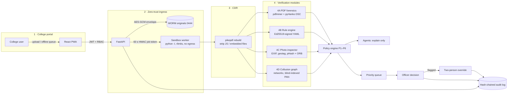

# SealCheck: Integrated AICTE Approval Workflow Automation, Compliance Monitoring and Alert Management (SIH 2026 · SIH26262)

**Approval workflow automation, compliance monitoring and alert management, with AI document verification built in.**

SealCheck is a prototype for Smart India Hackathon 2026 problem statement **SIH26262** (AICTE · Software · Smart Automation). It runs the AICTE approval process end to end:
- configurable **stage routing** with auto-advance and return/revert with reason
- **EVC** queueing, scheduling and summary
- **undertakings** with evidence and verification
- **lease and document validity** tracking and renewal
- **deadline reminders and escalation** to officers
- a **calendar**, **pendency dashboards**, CSV/PDF **reports** and a hash-chained **audit trail**

Its standout differentiator is **AI document verification** of every uploaded file: PDF forensics, DSC signature checks, photo forensics, cross-document consistency, issuer checks and evidence packets. Every file is treated as hostile (sandbox + Content Disarm & Reconstruction), and a deterministic policy engine assigns the status. **AI explains, humans decide:** officers take every decision, and flagged documents need a two-person override.

> **Safeguard:** Automated alerts, recommendations and workflow actions support the approval process. They do not replace statutory scrutiny, verification, inspections or decisions taken by the competent authority.

> Prototype status: prototype, not an official AICTE system. Everything in this repo runs end to end on one machine. Components that would be external services in production (HSM/KMS, DigiLocker/issuer registries, a container sandbox, the AICTE portal itself) are **simulated with clearly labelled adapters**. See [Real vs simulated](#real-vs-simulated). All demo data is synthetic.

## Problem statement SIH26262 → where SealCheck implements it

The left column paraphrases the problem statement's sections. "Partial" or "Gap" is stated honestly.

| Problem statement section | SealCheck feature | Screen | Files | Status |
|---|---|---|---|---|
| **A. Workflow automation**: configurable routes, automatic movement between stages, return/revert with reasons | Stage router with signed, versioned config; auto-advance on stage completion; return-to-institution and revert need a reason; stage history | Application page (workflow panel), `/workflow-config` | `backend/app/workflow.py`, `backend/app/rules/workflow.yaml`, `backend/app/wf_api.py`, `frontend/src/components/WorkflowPanel.tsx` | Done |
| **B. Monitoring dashboards**: pendency, ageing, bottlenecks, alerts | Pendency dashboard by region, stage, officer and institution; ageing buckets; overdue/approaching items; bottleneck stages (mean days); open alerts | `/pendency` | `backend/app/wf_reports.py`, `frontend/src/pages/Pendency.tsx` | Done |
| **C. EVC management**: queueing, scheduling, completion, reminders | EVC queue, schedule (date + members), member observations against a checklist, close visit, summarised EVC form (screen + PDF), visit reminders and escalation | `/evc` | `backend/app/workflow.py`, `frontend/src/pages/Evc.tsx` | Done |
| **D. Undertakings and compliance**: evidence, verification, escalation | Undertakings with due dates, evidence upload, officer verify/reject, escalation when overdue | `/compliance` (Undertakings tab) | `frontend/src/pages/Compliance.tsx`, `backend/app/wf_api.py` | Done |
| **E. Document validity**: lease, NOC and FDR expiry tracking and renewal | Validity end dates per document type, reminders 60/30/15/7/1 days before expiry, renewal upload + verification; DSC and validity-date checks during document verification | `/compliance` (Validity tab), document panel | `backend/app/workflow.py`, `backend/app/pipeline/rule_engine.py` | Done |
| **F. Alerts, notifications, reports, audit**: configurable notifications and escalation, CSV/PDF reports, full audit trail | Configurable reminder offsets and escalation ladders (Regional officer → Bureau officer → admin); in-app notifications (email only when SMTP is configured); a calendar with ICS feed; CSV/PDF reports; hash-chained audit log with verify | Bell, `/calendar`, `/reports`, `/audit` | `backend/app/notify.py`, `backend/app/wf_reports.py`, `backend/app/audit.py` | Done (email: needs SMTP) |
| **Key requirement: role-based access** | Roles: college, EVC member, Regional officer, Bureau officer, admin. Username + password accounts; non-college roles need admin approval | `/signup`, `/admin` | `backend/app/accounts.py`, [docs/ACCOUNTS_AND_ROLES.md](docs/ACCOUNTS_AND_ROLES.md) | Done |
| **Key requirement: integration with existing portals** | `PortalAdapter` interface for fetching applications and pushing stage changes/alerts; issuer-connector examples | `/workflow-config` (Integrations) | `backend/app/integrations.py`, `deploy/issuer-connectors.example.yaml` | **Gap:** interface only; not connected to any real AICTE or issuer system |
| **Key requirement: scheduled automation** | Idempotent deadline evaluator; daily Vercel cron (`/api/cron/evaluate`); dev background scheduler | `/workflow-config` (Scheduler runs) | `backend/app/workflow.py`, `vercel.json` | Done |
| **Key requirement: document verification** (differentiator) | PDF forensics (hidden text, overlays, incremental edits), DSC validation, photo forensics (EXIF, pHash/ORB reuse), cross-document core-field consistency, issuer registry checks, collusion graph, evidence packets | Application page, `/queue`, `/collusion` | `backend/app/pipeline/*`, `backend/app/crosscheck.py` | Done. Issuer checks use simulated registries |
| **Prototype criteria: working end-to-end demo** | Live deployment (Vercel + Neon Postgres, no demo data) plus a local demo with synthetic data and one-click personas | All | `run.sh`, `api/index.py`, `seed/` | Done |
| **Prototype criteria: human oversight** | Deterministic policy; AI agents explain only; officers decide; two-person override for flagged documents; safeguard notice in the UI | `/queue`, `/overrides` | `backend/app/pipeline/policy.py`, `backend/app/agents.py` | Done |
| **Prototype criteria: security and audit** | Sandbox + CDR, envelope encryption, WORM store, PII vault, bcrypt passwords with lockout, token revocation, hash-chained audit | `/security`, `/audit` | [docs/SECURITY.md](docs/SECURITY.md) | Done (sandbox is process-level on Vercel) |
| **Scale and performance** | Inline jobs on serverless; Redis queue + workers available for self-hosting | n/a | `docs/PRODUCTION.md` | **Not load-tested.** No performance figures are claimed |

Stage names, SLA days and region names are editable placeholders, not quotations from the AICTE Approval Process Handbook.

## Workflow, compliance and alerts (core)

Full detail is in [docs/WORKFLOW.md](docs/WORKFLOW.md). The architecture image is [docs/sealcheck_architecture_1920x1080.png](docs/sealcheck_architecture_1920x1080.png).

| Area | What you get | Where |
|---|---|---|
| Application wizard | Google-Form-like steps, a progress bar, drafts you can save and resume, per-step validation | `/apply` |
| Cross-document check | Core fields compared across documents. Each mismatch is returned to the institution as "to be corrected / re-uploaded" and flagged to officers | Wizard review, application page |
| Routes | Configurable stages and routes, auto-advance, return/revert with a reason | `rules/workflow.yaml`, `/workflow-config` |
| Reminders and escalation | Reminders before each deadline. After a missed deadline, escalation to the Regional officer, then the Bureau officer, then the admin | Daily cron, in-app and email (SMTP) |
| Calendar | Month and agenda views, ICS subscription | `/calendar` |
| Pendency | Ageing, bottlenecks, overdue, alerts, by region/stage/officer/institution | `/pendency` |
| EVC | Queue, scheduling, member observations, completion, a summarised EVC form (one page + detail, on screen and PDF) | `/evc` |
| Undertakings and validity | Evidence, verification and escalation. Validity expiry tracking and renewal | `/compliance` |
| Reports | CSV and PDF exports; every action is in the hash-chained audit trail | `/reports` |
| Integration hooks | `PortalAdapter` interface only. Not connected to any real AICTE system | `backend/app/integrations.py` |

Stage names, SLA days and region names are **editable placeholders**, not quotations from the AICTE Approval Process Handbook.

## Architecture (AI document verification pipeline)



Details: [docs/ARCHITECTURE.md](docs/ARCHITECTURE.md)

## Feature map (architecture image → code)

| Image box | What it does | Files |
|---|---|---|
| **1 · College portal / readiness** | Applications, checklist, uploads, offline queue, pre-check, templates, rejection helper | `frontend/src/pages/{Dashboard,Applications,NewApplication,ApplicationDetail,Readiness}.tsx`, `frontend/src/lib/offline.ts`, `frontend/public/sw.js` |
| **2 · Zero-trust ingress** | JWT + RBAC, sandbox worker, job tokens, envelope encryption, WORM store, PII vault | `backend/app/security.py`, `backend/app/worker.py`, `backend/app/main.py`, `frontend/src/pages/Security.tsx` |
| **3 · CDR** | Rebuild PDFs and strip active content | `backend/app/pipeline/cdr.py` |
| **4A–4D · Verification** | PDF forensics + DSC, signed rule bundle, photo inspector, collusion graph | `backend/app/pipeline/{gateway,forensics,rule_engine,photo}.py`, `backend/app/main.py` (collusion graph), `backend/app/rules/`, `backend/app/rules_bundle.py`, `frontend/src/pages/Collusion.tsx`, `frontend/src/components/DocPanel.tsx` |
| **Policy, agents, decisions** | Statuses P1–P6, explanations, Q&A, priority queue, decisions, overrides, PDFs | `backend/app/pipeline/policy.py`, `backend/app/agents.py`, `backend/app/qa.py`, `backend/app/reports.py`, `frontend/src/pages/{Queue,Overrides}.tsx` |
| **Audit & governance** | Hash chain, verify, rules viewer, admin health | `backend/app/audit.py`, `frontend/src/pages/{Audit,Rules,Admin}.tsx` |

## Quick start

**Required:** Python 3.11 or newer, and Node 18 or newer (Node is only needed for the first UI build).

**Optional,** each with an automatic fallback that `run.sh` reports at start-up:

| Package | Used for | Fallback when missing |
|---|---|---|
| `bubblewrap` | namespace sandbox | `process` sandbox (dev only) |
| `tesseract` | OCR of scanned PDFs | OCR skipped |
| `clamav` | malware scan | heuristic scanner |
| `poppler-utils` | screenshot scripts only | — |

```bash
# from a git clone, or after unzipping SealCheck_prototype.zip
cd SealCheck                 # or the cloned folder
./run.sh                       # creates .venv, installs deps, seeds demo data, builds the UI, serves on :8000
# open http://localhost:8000   (API docs: http://localhost:8000/docs)
PORT=8010 SEALCHECK_DATA_DIR=/tmp/sealcheck ./run.sh    # another port + its own data directory
```

The first run takes about 1–3 minutes on a normal connection, mostly pip and npm installs. Later starts take a few seconds.

**macOS:** the same `./run.sh` works. bubblewrap does not exist on macOS, so the sandbox uses the `process` fallback, with a warning.

**Windows:** use WSL2 (Ubuntu) and run `./run.sh` there. This is recommended. Natively in PowerShell, do it by hand:
1. `py -3.11 -m venv .venv`
2. `.venv\Scripts\pip install -r requirements-dev.txt`
3. `python seed\generate_samples.py; python seed\seed_db.py --force`
4. `cd frontend; npm install; npm run build; cd ..`
5. `cd backend; ..\.venv\Scripts\uvicorn app.main:app --port 8000`

Native Windows is not tested. The sandbox's POSIX rlimits are not available there.

`RESEED=1 ./run.sh` resets the demo data. `SEALCHECK_DEMO_PACE_MS=700 ./run.sh` adds an artificial per-stage delay so an audience can watch the live pipeline. It is off by default, and the timings shown while it is on include the delay. `make test` runs pytest, and `make smoke` runs the E2E smoke test against a running server.

**Demo accounts** (password `Demo@2026` for all; you can also click a card on the login page):

| Role | Email |
|---|---|
| College principals | `principal.svit@`, `principal.gvce@`, `principal.diem@`, `principal.mct@` + `sealcheck.demo` |
| Scrutiny officers | `officer@sealcheck.demo`, `officer2@sealcheck.demo` |
| Senior officer | `senior@sealcheck.demo` |
| Admin | `admin@sealcheck.demo` |

## 3-minute judge demo

The quickest route is the built-in tour. Sign in as **officer** and click **Start 3-minute demo tour** on the dashboard. It walks through seven highlighted steps: queue → forged application → evidence highlight → agent debate → override request → second-officer approval (one click switches persona) → audit verify. It runs entirely in the browser and uses no external service. The manual path is:

Full script with talking points: [docs/DEMO_SCRIPT.md](docs/DEMO_SCRIPT.md).

1. **0:00** Sign in as **officer**. The dashboard shows the priority queue, ordered by 0.5·risk + 0.3·deadline + 0.2·waiting time.
2. **0:30** Open **GVCE-0002** and click the forged land lease. The evidence viewer highlights the hidden white text and the masking overlay on the page. The 4A tab shows the forensics detail.
3. **1:15** Try **Approve**. It is blocked (409) and a two-person override is required. Request an override, sign in as **senior**, and approve it. The same person cannot do both.
4. **1:45** Open **Collusion graph**. A faculty PAN is shared between SVIT and GVCE (matched by blind index), and DIEM reuses a lab photo (pHash).
5. **2:15** Open **Security center**. Watch a 60-second job token expire, run the KMS demo, and verify the audit chain.
6. **2:40** Sign in as **principal.gvce**. Use the readiness pre-check, the rejection helper and the offline queue (DevTools → offline → upload), and switch themes.

## Production deployment on Vercel (https://sealcheck-nu.vercel.app)

`vercel.json`, `api/index.py`, `requirements.txt` and `.python-version` deploy the app. The Vite build is served from the CDN,
and FastAPI runs as one Python function. **Nothing runs in demo mode:** `ENV=production`, there are no demo accounts or sample data,
and the database starts empty apart from the signed rule bundle.

| Setting | Value |
|---|---|
| Database | free **Neon Postgres** (Vercel integration, `DATABASE_URL`). Migrations and seeding run under an advisory lock |
| File storage | `STORAGE_BACKEND=db`: original and sanitised files go in Postgres `bytea`, insert-only and sha256-verified on every read, so every instance sees the same files |
| Login | `AUTH_MODE=password`: **username + password** signup and sign-in, with roles (College representative, EVC member, Regional officer, Bureau officer). Only a first college representative gets access straight away. Every other role waits for an administrator. Passwords are hashed with bcrypt; there is lockout, token-version logout-everywhere and admin reset. The first admin comes from `SEALCHECK_BOOTSTRAP_ADMIN_USERNAME`/`_PASSWORD`. See [docs/ACCOUNTS_AND_ROLES.md](docs/ACCOUNTS_AND_ROLES.md). Google/OIDC are optional and off |
| Cron | `vercel.json` `crons` → `GET /api/cron/evaluate` daily 02:30 UTC (08:00 IST), with `Authorization: Bearer $CRON_SECRET`: deadline reminders and escalation |
| Keys | `SEALCHECK_MASTER_KEY` → HKDF-derived sub-keys (identical on every instance); `SEALCHECK_JWT_SECRET` |
| Jobs / sandbox | `QUEUE_BACKEND=inline` (each upload is analysed within its request); `process` sandbox (rlimits; Vercel has no bubblewrap), explicitly accepted with `SEALCHECK_ACCEPT_PROCESS_SANDBOX=1` |
| Vision | `classic` (pHash + ORB) in the function. Deep models run in the separate [vision_service/](vision_service/) (Docker / Hugging Face Space); point `VISION_BACKEND=remote`, `VISION_REMOTE_URL` and `VISION_REMOTE_TOKEN` at it |

Operator tasks, such as creating an account by hand, issuing a short-lived token or deleting a user, use `scripts/admin.py`
(every action is audit-logged; WORM blobs and audit entries are never deleted).

```bash
vercel env add AUTH_MODE production                          # password
vercel env add SEALCHECK_BOOTSTRAP_ADMIN_USERNAME production
vercel env add SEALCHECK_BOOTSTRAP_ADMIN_PASSWORD production --sensitive   # strong, generated; or use /setup while there are 0 admins
vercel env add CRON_SECRET production --sensitive
vercel deploy --prod
```

## Demo deployment (Render)

`render.yaml` defines one Docker web service, `sealcheck-demo`. On every boot it creates a fresh SQLite database with synthetic demo data. It runs with `ENV=demo` and `AUTH_MODE=local`, and the JWT secret is set with `generateValue`. No secrets are committed.

The Render free plan has no persistent disk, so all data resets on restart. The Docker image has not been built on the build box.

For a real deployment, see docs/PRODUCTION.md.

## Themes and accessibility

The default theme is **AICTE Portal**: a government-portal look. It is not a copy of the portal.

**Colours** were sampled from aicte.gov.in on 29 Oct 2026:

| Colour | Hex | Used for |
|---|---|---|
| Navy | `#032761` | nav, section heads, footer |
| Amber | `#FFB703` | highlights |
| Link blue | `#0079C0` | active nav. Link text is darkened to `#006AA8` for 4.5:1 contrast. |
| Text | `#343A40` / `#212529` | body text |
| Page | `#F7F7F7` | background |
| Border | `#D6DDEB` | borders |
| Utility bar | `#181818` | top utility bar |
| Orange | `#F75700` | darkened to `#B34000` for accent text |

**Fonts:** Open Sans and Noto Sans Devanagari, bundled locally (SIL OFL, via @fontsource). No CDN is used.

**What's in the theme:**
- a top bar with a Hindi line and a tricolour strip;
- a utility bar: skip link, A-/A/A+, English or Hindi nav labels, high contrast and dark mode;
- breadcrumbs and a government-style footer.

**What's not in it:** no AICTE logo, no Government of India emblem and no copied images. The shield is our own mark. Every page says **"Prototype - not an official AICTE system"**. The sign-in page warns users not to enter real AICTE credentials.

Other themes (AICTE Blue, Emerald, Indigo, Saffron) and dark mode are still under *Settings & themes*.

## Real vs simulated

"Mock-tested" means the code path ran against a local stand-in: moto, fakeredis, a mock HTTP server, `devtools/mock_oidc.py`, or locally built OCSP/CRL responses. It has **not** been verified against the real service. The full list of variables and operator inputs is in [docs/PRODUCTION.md](docs/PRODUCTION.md).

| Component | What runs here | Status |
|---|---|---|
| CDR (pikepdf rebuild), PDF forensics (pdfminer), rule engine with an Ed25519-signed bundle, collusion graph, audit hash chain | real code on synthetic documents | **Real, tested** |
| DSC validation (pyHanko) | real cryptography, checked against a **demo trust root** | Real; production needs the CCA India roots (operator input) |
| OCSP / CRL revocation, issuer-registry connectors | host-side client with cache and circuit breaker | **Mock-tested only**; no real responder or registry has been contacted |
| Sandbox | bubblewrap namespaces + seccomp + rlimits, with no network | **Real, tested here** (including escape tests). The Docker/gVisor backend is argv-tested only |
| Database | SQLite (dev) / PostgreSQL 16 + pgvector | **Both tested** (full suite runs on each) |
| Login | Google sign-in (production) / local demo login (`ENV=development` only) / generic OIDC + MFA | OIDC **mock-tested only** (mock IdP, not Keycloak) |
| KMS | soft KMS (dev), AWS KMS, Vault Transit, PKCS#11 | soft real; AWS moto-tested; Vault mock-tested; **PKCS#11 untested** |
| WORM storage | chmod 0444 (dev), S3 Object Lock COMPLIANCE | fs real; **S3 moto-tested only** |
| Job queue | thread (dev), PG `SKIP LOCKED`, RQ/Redis | thread and PG real; RQ fakeredis-tested only |
| Photo vision | pHash + ORB (default); DINOv2 + RT-DETR + LightGlue (`VISION_BACKEND=models`, or `remote` via `vision_service/`) | Both real. Thresholds were **calibrated on a synthetic set only** ([ml/eval/REPORT.md](ml/eval/REPORT.md): held-out synthetic P 1.00 / R 0.67 classic, P 0.98 / R 0.70 models; mirrored reuse is mostly missed). RT-DETR is COCO-only and was not evaluated on lab equipment |
| Google sign-in | OIDC code + PKCE against Google, ID-token signature and claims checked server-side | Code **mock-IdP-tested** end to end; live only once the user adds the Google OAuth client |
| Production hosting | Vercel + Neon Postgres, blobs in Postgres | **Live**, verified with a temporary account (since deleted) |
| LLM wording | off by default; OpenAI-compatible / Anthropic / Ollama | **Mock-tested only**; guarded so it cannot change a status |
| Alerts | in-app, SMTP, SMS, webhook, Slack, SIEM | in-app and SIEM-to-file real; SMTP tested against a local aiosmtpd; the rest are mock-HTTP-tested |
| Docker Compose / Kubernetes / CI | files provided | **Not run** (no Docker on the build box); syntax-checked only |
| Voice assistant | browser Web Speech API | depends on the browser |
| Sample documents and photos | generated by `seed/generate_samples.py` | **Synthetic** |

No real-world accuracy or throughput numbers are claimed, because nothing has been benchmarked on real data; the only figures are the clearly labelled synthetic ones in ml/eval/REPORT.md. Each document shows its own measured analysis time.

## Security model

Summary below. Full details are in [docs/SECURITY.md](docs/SECURITY.md).
- JWT sessions and role-based access (college / officer / senior officer / admin). Colleges can only see their own data.
- Uploads are checked for size and type, processed in the sandbox with a 60-second HMAC job token, and run through CDR. Originals are envelope-encrypted and kept read-only.
- PAN numbers are stored encrypted and matched only by blind index. Revealing one is admin-only and audited.
- An approval that touches a flagged document needs two different people (officer → senior officer).
- Every action is appended to a SHA-256 hash chain, which `/api/audit/verify` recomputes.
- Sign-in is rate-limited after 10 failures per minute per IP.

## API

Interactive OpenAPI docs are at **`/docs`** on the running server. An endpoint summary is in [docs/API.md](docs/API.md).

## Repository layout

```
backend/   FastAPI app, pipeline modules, sandbox worker, rules bundle
frontend/  React + TypeScript + Vite + Tailwind PWA (fonts bundled locally)
seed/      synthetic sample generator, DB seeder, templates
tests/     pytest suite
scripts/   smoke.py (E2E), screenshots.py (Playwright, 28 shots)
docs/      architecture, API, demo script, security
```

## Roadmap

1. Replace the demo trust root with the CCA India root store and add OCSP/CRL checks.
2. Add real issuer-registry adapters (DigiLocker, state fire services, land records).
3. Move the sandbox to gVisor/Firecracker and the KMS to an HSM-backed service.
4. Add Postgres, an object-locked store and a horizontally scaled worker queue.
5. Add OCR for scanned documents and Indic-language support for the voice assistant.
6. Benchmark accuracy on a labelled real-world dataset before any accuracy claims are made.

## License

MIT. See [LICENSE](LICENSE).
